# THRIFTFLIP: ER diagram and data dictionary

_Generated by `scripts/gen_docs.py` from `db/migrations/*.sql`. Do not edit by hand; edit the SQL and re-run the script._

Relationship notation: `||` exactly one, `|o` zero or one, `o{` zero or many, `o|` zero or one (one-to-one).

## ER diagram

```mermaid
erDiagram
    campus {
        SERIAL campus_id PK
        TEXT name UK
        TEXT city
    }
    department {
        SERIAL department_id PK
        INTEGER campus_id FK
        TEXT name
    }
    course {
        SERIAL course_id PK
        INTEGER department_id FK
        TEXT code
        TEXT name
        INTEGER semester
    }
    college_email_domain {
        TEXT domain PK
    }
    student {
        SERIAL student_id PK
        TEXT srn UK
        TEXT name
        TEXT email UK
        TEXT password_hash
        INTEGER campus_id FK
        INTEGER department_id FK
        TEXT program
        INTEGER semester
        BOOLEAN email_verified
        TIMESTAMPTZ email_verified_at
        TEXT contact_preference
        TEXT phone
        BOOLEAN show_contact
        TEXT status
        INTEGER warning_count
        TIMESTAMPTZ created_at
    }
    auth_token {
        TEXT token_hash PK
        INTEGER student_id FK
        TEXT purpose
        TIMESTAMPTZ expires_at
        TIMESTAMPTZ used_at
        TIMESTAMPTZ created_at
    }
    image {
        SERIAL image_id PK
        INTEGER owner_id FK
        TEXT purpose
        TEXT content_type
        INTEGER size_bytes
        BYTEA data
        TIMESTAMPTZ created_at
    }
    admin {
        SERIAL admin_id PK
        TEXT name
        TEXT email UK
        TEXT password_hash
        TIMESTAMPTZ created_at
    }
    book {
        SERIAL book_id PK
        TEXT isbn UK
        TEXT title
        TEXT author
        INTEGER edition
        TEXT subject
        INTEGER course_id FK
    }
    listing {
        SERIAL listing_id PK
        INTEGER seller_id FK
        INTEGER book_id FK
        INTEGER campus_id FK
        TEXT category
        TEXT title
        TEXT description
        TEXT item_condition
        TEXT listing_type
        NUMERIC price
        TEXT status
        BOOLEAN open_to_swap
        TSVECTOR search_vector
        TIMESTAMPTZ created_at
        TIMESTAMPTZ updated_at
    }
    listing_image {
        INTEGER listing_id PK,FK
        INTEGER image_id PK,FK
        INTEGER position
    }
    recently_viewed {
        INTEGER student_id PK,FK
        INTEGER listing_id PK,FK
        TIMESTAMPTZ viewed_at
    }
    auction {
        SERIAL auction_id PK
        INTEGER listing_id FK
        NUMERIC starting_price
        NUMERIC min_increment
        TIMESTAMPTZ start_time
        TIMESTAMPTZ end_time
        TIMESTAMPTZ original_end_time
        NUMERIC current_price
        INTEGER highest_bidder_id FK
        INTEGER winner_id FK
        TEXT status
        INTEGER extension_count
        TIMESTAMPTZ closed_at
    }
    bid {
        SERIAL bid_id PK
        INTEGER auction_id FK
        INTEGER bidder_id FK
        NUMERIC amount
        TIMESTAMPTZ placed_at
        NUMERIC seconds_before_end
        TEXT status
    }
    offer {
        SERIAL offer_id PK
        INTEGER listing_id FK
        INTEGER buyer_id FK
        NUMERIC amount
        TEXT message
        TEXT status
        TIMESTAMPTZ created_at
        TIMESTAMPTZ responded_at
    }
    wishlist {
        INTEGER student_id PK,FK
        INTEGER listing_id PK,FK
        TIMESTAMPTZ created_at
    }
    swap_preference {
        SERIAL preference_id PK
        INTEGER student_id FK
        INTEGER offered_listing_id FK
        INTEGER wanted_book_id FK
        TIMESTAMPTZ created_at
    }
    swap_request {
        SERIAL swap_request_id PK
        UUID cycle_id
        INTEGER requester_id FK
        INTEGER offered_listing_id FK
        INTEGER requested_listing_id FK
        TEXT status
        TIMESTAMPTZ created_at
        TIMESTAMPTZ responded_at
    }
    transactions {
        SERIAL transaction_id PK
        INTEGER listing_id FK
        INTEGER buyer_id FK
        INTEGER seller_id FK
        NUMERIC amount
        TEXT transaction_type
        INTEGER swap_request_id FK
        TEXT state
        TIMESTAMPTZ created_at
        TIMESTAMPTZ updated_at
    }
    transaction_state_history {
        SERIAL history_id PK
        INTEGER transaction_id FK
        TEXT previous_state
        TEXT new_state
        TEXT changed_by_type
        INTEGER changed_by_id
        TIMESTAMPTZ changed_at
    }
    waitlist {
        SERIAL waitlist_id PK
        INTEGER listing_id FK
        INTEGER student_id FK
        TEXT status
        TIMESTAMPTZ joined_at
        TIMESTAMPTZ notified_at
        TIMESTAMPTZ claim_expires_at
    }
    rating {
        SERIAL rating_id PK
        INTEGER transaction_id FK
        INTEGER rater_id FK
        INTEGER ratee_id FK
        INTEGER score
        TIMESTAMPTZ created_at
    }
    review {
        SERIAL review_id PK
        INTEGER rating_id FK
        TEXT body
        TIMESTAMPTZ created_at
    }
    conversation {
        SERIAL conversation_id PK
        INTEGER listing_id FK
        INTEGER buyer_id FK
        INTEGER seller_id FK
        TIMESTAMPTZ created_at
    }
    message {
        SERIAL message_id PK
        INTEGER conversation_id FK
        INTEGER sender_id FK
        TEXT body
        TIMESTAMPTZ sent_at
        TIMESTAMPTZ read_at
    }
    notification {
        SERIAL notification_id PK
        INTEGER student_id FK
        TEXT type
        TEXT title
        TEXT body
        INTEGER related_listing_id FK
        BOOLEAN is_read
        TIMESTAMPTZ created_at
    }
    report {
        SERIAL report_id PK
        INTEGER reporter_id FK
        INTEGER reported_listing_id FK
        INTEGER reported_student_id FK
        TEXT reason
        TEXT details
        TEXT status
        INTEGER resolved_by FK
        TIMESTAMPTZ resolved_at
        TIMESTAMPTZ created_at
    }
    price_alert {
        SERIAL alert_id PK
        INTEGER student_id FK
        INTEGER book_id FK
        NUMERIC max_price
        BOOLEAN is_active
        TIMESTAMPTZ created_at
        TIMESTAMPTZ triggered_at
    }
    search_activity {
        SERIAL search_id PK
        INTEGER student_id FK
        TEXT query_text
        TEXT search_type
        INTEGER book_id FK
        INTEGER course_id FK
        TIMESTAMPTZ searched_at
    }
    listing_embedding {
        INTEGER listing_id PK,FK
        vector embedding
        TEXT source_text
        TEXT model_name
        TIMESTAMPTZ updated_at
    }
    campus ||--o{ department : "campus_id"
    department ||--o{ course : "department_id"
    campus ||--o{ student : "campus_id"
    department ||--o{ student : "department_id"
    student ||--o{ auth_token : "student_id"
    student ||--o{ image : "owner_id"
    course |o--o{ book : "course_id"
    student ||--o{ listing : "seller_id"
    book |o--o{ listing : "book_id"
    campus ||--o{ listing : "campus_id"
    listing ||--o{ listing_image : "listing_id"
    image ||--o{ listing_image : "image_id"
    student ||--o{ recently_viewed : "student_id"
    listing ||--o{ recently_viewed : "listing_id"
    listing ||--o| auction : "listing_id"
    student |o--o{ auction : "highest_bidder_id"
    student |o--o{ auction : "winner_id"
    auction ||--o{ bid : "auction_id"
    student ||--o{ bid : "bidder_id"
    listing ||--o{ offer : "listing_id"
    student ||--o{ offer : "buyer_id"
    student ||--o{ wishlist : "student_id"
    listing ||--o{ wishlist : "listing_id"
    student ||--o{ swap_preference : "student_id"
    listing ||--o{ swap_preference : "offered_listing_id"
    book ||--o{ swap_preference : "wanted_book_id"
    student ||--o{ swap_request : "requester_id"
    listing ||--o{ swap_request : "offered_listing_id"
    listing ||--o{ swap_request : "requested_listing_id"
    listing ||--o{ transactions : "listing_id"
    student ||--o{ transactions : "buyer_id"
    student ||--o{ transactions : "seller_id"
    swap_request |o--o{ transactions : "swap_request_id"
    transactions ||--o{ transaction_state_history : "transaction_id"
    listing ||--o{ waitlist : "listing_id"
    student ||--o{ waitlist : "student_id"
    transactions ||--o{ rating : "transaction_id"
    student ||--o{ rating : "rater_id"
    student ||--o{ rating : "ratee_id"
    rating ||--o| review : "rating_id"
    listing ||--o{ conversation : "listing_id"
    student ||--o{ conversation : "buyer_id"
    student ||--o{ conversation : "seller_id"
    conversation ||--o{ message : "conversation_id"
    student ||--o{ message : "sender_id"
    student ||--o{ notification : "student_id"
    listing |o--o{ notification : "related_listing_id"
    student ||--o{ report : "reporter_id"
    listing |o--o{ report : "reported_listing_id"
    student |o--o{ report : "reported_student_id"
    admin |o--o{ report : "resolved_by"
    student ||--o{ price_alert : "student_id"
    book ||--o{ price_alert : "book_id"
    student |o--o{ search_activity : "student_id"
    book |o--o{ search_activity : "book_id"
    course |o--o{ search_activity : "course_id"
    listing ||--o| listing_embedding : "listing_id"
```

## Relational schema

- **campus**(__campus_id__, name, city)
- **department**(__department_id__, campus_id (FK -> campus), name)
- **course**(__course_id__, department_id (FK -> department), code, name, semester)
- **college_email_domain**(__domain__)
- **student**(__student_id__, srn, name, email, password_hash, campus_id (FK -> campus), department_id (FK -> department), program, semester, email_verified, email_verified_at, contact_preference, phone, show_contact, status, warning_count, created_at)
- **auth_token**(__token_hash__, student_id (FK -> student), purpose, expires_at, used_at, created_at)
- **image**(__image_id__, owner_id (FK -> student), purpose, content_type, size_bytes, data, created_at)
- **admin**(__admin_id__, name, email, password_hash, created_at)
- **book**(__book_id__, isbn, title, author, edition, subject, course_id (FK -> course))
- **listing**(__listing_id__, seller_id (FK -> student), book_id (FK -> book), campus_id (FK -> campus), category, title, description, item_condition, listing_type, price, status, open_to_swap, search_vector, created_at, updated_at)
- **listing_image**(listing_id (FK -> listing), image_id (FK -> image), position)
- **recently_viewed**(student_id (FK -> student), listing_id (FK -> listing), viewed_at)
- **auction**(__auction_id__, listing_id (FK -> listing), starting_price, min_increment, start_time, end_time, original_end_time, current_price, highest_bidder_id (FK -> student), winner_id (FK -> student), status, extension_count, closed_at)
- **bid**(__bid_id__, auction_id (FK -> auction), bidder_id (FK -> student), amount, placed_at, seconds_before_end, status)
- **offer**(__offer_id__, listing_id (FK -> listing), buyer_id (FK -> student), amount, message, status, created_at, responded_at)
- **wishlist**(student_id (FK -> student), listing_id (FK -> listing), created_at)
- **swap_preference**(__preference_id__, student_id (FK -> student), offered_listing_id (FK -> listing), wanted_book_id (FK -> book), created_at)
- **swap_request**(__swap_request_id__, cycle_id, requester_id (FK -> student), offered_listing_id (FK -> listing), requested_listing_id (FK -> listing), status, created_at, responded_at)
- **transactions**(__transaction_id__, listing_id (FK -> listing), buyer_id (FK -> student), seller_id (FK -> student), amount, transaction_type, swap_request_id (FK -> swap_request), state, created_at, updated_at)
- **transaction_state_history**(__history_id__, transaction_id (FK -> transactions), previous_state, new_state, changed_by_type, changed_by_id, changed_at)
- **waitlist**(__waitlist_id__, listing_id (FK -> listing), student_id (FK -> student), status, joined_at, notified_at, claim_expires_at)
- **rating**(__rating_id__, transaction_id (FK -> transactions), rater_id (FK -> student), ratee_id (FK -> student), score, created_at)
- **review**(__review_id__, rating_id (FK -> rating), body, created_at)
- **conversation**(__conversation_id__, listing_id (FK -> listing), buyer_id (FK -> student), seller_id (FK -> student), created_at)
- **message**(__message_id__, conversation_id (FK -> conversation), sender_id (FK -> student), body, sent_at, read_at)
- **notification**(__notification_id__, student_id (FK -> student), type, title, body, related_listing_id (FK -> listing), is_read, created_at)
- **report**(__report_id__, reporter_id (FK -> student), reported_listing_id (FK -> listing), reported_student_id (FK -> student), reason, details, status, resolved_by (FK -> admin), resolved_at, created_at)
- **price_alert**(__alert_id__, student_id (FK -> student), book_id (FK -> book), max_price, is_active, created_at, triggered_at)
- **search_activity**(__search_id__, student_id (FK -> student), query_text, search_type, book_id (FK -> book), course_id (FK -> course), searched_at)
- **listing_embedding**(__listing_id__ (FK -> listing), embedding, source_text, model_name, updated_at)

## Data dictionary

### campus

| Column | Type | Constraints | Description |
|---|---|---|---|
| campus_id | SERIAL | PRIMARY KEY | surrogate key of the campus |
| name | TEXT | NOT NULL UNIQUE | campus name |
| city | TEXT | NOT NULL | city where the campus is located |

### department

| Column | Type | Constraints | Description |
|---|---|---|---|
| department_id | SERIAL | PRIMARY KEY | surrogate key of the department |
| campus_id | INTEGER | NOT NULL REFERENCES campus(campus_id) | campus the department belongs to |
| name | TEXT | NOT NULL | department name |

Table constraints: `UNIQUE (campus_id, name)`

### course

| Column | Type | Constraints | Description |
|---|---|---|---|
| course_id | SERIAL | PRIMARY KEY | surrogate key of the course |
| department_id | INTEGER | NOT NULL REFERENCES department(department_id) | department offering the course |
| code | TEXT | NOT NULL | course code, e.g. UE23CS201 |
| name | TEXT | NOT NULL | course title |
| semester | INTEGER | NOT NULL | semester in which the course is taught (1 to 8) |

Table constraints: `UNIQUE (department_id, code)`

CHECK constraints:
- `ck_course_semester`: `semester BETWEEN 1 AND 8`

### college_email_domain

| Column | Type | Constraints | Description |
|---|---|---|---|
| domain | TEXT | PRIMARY KEY | allowed college e-mail domain (sub-domains are accepted too), lower case |

CHECK constraints:
- `ck_domain_format`: `domain = lower(domain) AND domain ~ '^[a-z0-9]([a-z0-9.-]*[a-z0-9])?\.[a-z]{2,}$'`

### student

| Column | Type | Constraints | Description |
|---|---|---|---|
| student_id | SERIAL | PRIMARY KEY | surrogate key of the student |
| srn | TEXT | NOT NULL UNIQUE | university student ID (SRN), upper-case letters and digits |
| name | TEXT | NOT NULL | full name |
| email | TEXT | NOT NULL UNIQUE | college e-mail, stored in lower case (domain checked by trigger) |
| password_hash | TEXT | NOT NULL | bcrypt hash of the independent THRIFTFLIP password |
| campus_id | INTEGER | NOT NULL REFERENCES campus(campus_id) | campus of the department (filled by trigger) |
| department_id | INTEGER | NOT NULL REFERENCES department(department_id) | B.Tech department |
| program | TEXT | NOT NULL DEFAULT 'B.Tech' | degree programme (only B.Tech for now) |
| semester | INTEGER | NOT NULL | current semester (1 to 8) |
| email_verified | BOOLEAN | NOT NULL DEFAULT false | true after the e-mail link was used |
| email_verified_at | TIMESTAMPTZ | - | time of verification |
| contact_preference | TEXT | NOT NULL DEFAULT 'IN_APP' | IN_APP, EMAIL or PHONE |
| phone | TEXT | - | optional phone number |
| show_contact | BOOLEAN | NOT NULL DEFAULT false | show the preferred contact method to buyers |
| status | TEXT | NOT NULL DEFAULT 'ACTIVE' | ACTIVE or SUSPENDED |
| warning_count | INTEGER | NOT NULL DEFAULT 0 | number of moderation warnings |
| created_at | TIMESTAMPTZ | NOT NULL DEFAULT now() | registration time |

CHECK constraints:
- `ck_student_email`: `email ~ '^[^@[:space:]]+@[^@[:space:]]+\.[^@[:space:]]+$' AND email = lower(email)`
- `ck_student_srn`: `srn ~ '^[A-Z0-9]{8,20}$'`
- `ck_student_semester`: `semester BETWEEN 1 AND 8`
- `ck_student_program`: `program = 'B.Tech'`
- `ck_student_contact_pref`: `contact_preference IN ('IN_APP', 'EMAIL', 'PHONE')`
- `ck_student_phone`: `phone IS NULL OR phone ~ '^\+?[0-9]{10,13}$'`
- `ck_student_phone_needed`: `contact_preference <> 'PHONE' OR phone IS NOT NULL`
- `ck_student_status`: `status IN ('ACTIVE', 'SUSPENDED')`
- `ck_student_warnings`: `warning_count >= 0`
- `ck_student_password_hash`: `char_length(password_hash) >= 20`

### auth_token

| Column | Type | Constraints | Description |
|---|---|---|---|
| token_hash | TEXT | PRIMARY KEY | SHA-256 of the secret token sent by e-mail (the token itself is never stored) |
| student_id | INTEGER | NOT NULL REFERENCES student(student_id) ON DELETE CASCADE | student the token belongs to |
| purpose | TEXT | NOT NULL | VERIFY_EMAIL or RESET_PASSWORD |
| expires_at | TIMESTAMPTZ | NOT NULL | token is invalid after this time |
| used_at | TIMESTAMPTZ | - | set when the token was used (single use) |
| created_at | TIMESTAMPTZ | NOT NULL DEFAULT now() | creation time |

CHECK constraints:
- `ck_auth_token_purpose`: `purpose IN ('VERIFY_EMAIL', 'RESET_PASSWORD')`

### image

| Column | Type | Constraints | Description |
|---|---|---|---|
| image_id | SERIAL | PRIMARY KEY | surrogate key of the image |
| owner_id | INTEGER | NOT NULL REFERENCES student(student_id) ON DELETE CASCADE | student who uploaded it |
| purpose | TEXT | NOT NULL | PROFILE or LISTING |
| content_type | TEXT | NOT NULL | image/jpeg, image/png or image/webp |
| size_bytes | INTEGER | NOT NULL | file size in bytes (max 2 MB) |
| data | BYTEA | NOT NULL | the image file itself |
| created_at | TIMESTAMPTZ | NOT NULL DEFAULT now() | upload time |

CHECK constraints:
- `ck_image_purpose`: `purpose IN ('PROFILE', 'LISTING')`
- `ck_image_type`: `content_type IN ('image/jpeg', 'image/png', 'image/webp')`
- `ck_image_size`: `size_bytes BETWEEN 1 AND 2097152`

### admin

| Column | Type | Constraints | Description |
|---|---|---|---|
| admin_id | SERIAL | PRIMARY KEY | surrogate key of the administrator |
| name | TEXT | NOT NULL | full name |
| email | TEXT | NOT NULL UNIQUE | login e-mail, stored in lower case |
| password_hash | TEXT | NOT NULL | bcrypt hash of the admin password |
| created_at | TIMESTAMPTZ | NOT NULL DEFAULT now() | creation time |

CHECK constraints:
- `ck_admin_email`: `email ~ '^[^@[:space:]]+@[^@[:space:]]+\.[^@[:space:]]+$' AND email = lower(email)`
- `ck_admin_password_hash`: `char_length(password_hash) >= 20`

### book

| Column | Type | Constraints | Description |
|---|---|---|---|
| book_id | SERIAL | PRIMARY KEY | surrogate key of the book edition |
| isbn | TEXT | UNIQUE | ISBN-10 or ISBN-13 without hyphens (optional) |
| title | TEXT | NOT NULL | book title |
| author | TEXT | NOT NULL | author name(s) |
| edition | INTEGER | NOT NULL DEFAULT 1 | edition number |
| subject | TEXT | NOT NULL | subject area, e.g. Machine Learning |
| course_id | INTEGER | REFERENCES course(course_id) | course that recommends the book (optional) |

CHECK constraints:
- `ck_book_edition`: `edition >= 1`
- `ck_book_isbn`: `isbn IS NULL OR isbn ~ '^([0-9]{9}[0-9X]|[0-9]{13})$'`

### listing

| Column | Type | Constraints | Description |
|---|---|---|---|
| listing_id | SERIAL | PRIMARY KEY | surrogate key of the listing |
| seller_id | INTEGER | NOT NULL REFERENCES student(student_id) | student who owns the item |
| book_id | INTEGER | REFERENCES book(book_id) | book edition (required for textbooks, NULL for goods) |
| campus_id | INTEGER | NOT NULL REFERENCES campus(campus_id) | campus where the item is available |
| category | TEXT | NOT NULL DEFAULT 'TEXTBOOK' | TEXTBOOK or GOODS |
| title | TEXT | NOT NULL | listing title |
| description | TEXT | NOT NULL DEFAULT '' | free-text description |
| item_condition | TEXT | NOT NULL | NEW, LIKE_NEW, GOOD, FAIR or POOR |
| listing_type | TEXT | NOT NULL DEFAULT 'FIXED_PRICE' | FIXED_PRICE or AUCTION |
| price | NUMERIC(10,2) | NOT NULL | asking price (starting price for auctions) |
| status | TEXT | NOT NULL DEFAULT 'ACTIVE' | ACTIVE, RESERVED, SOLD, SWAPPED or REMOVED |
| open_to_swap | BOOLEAN | NOT NULL DEFAULT false | seller accepts swaps for this item |
| search_vector | TSVECTOR | - | full-text search document, maintained by trigger |
| created_at | TIMESTAMPTZ | NOT NULL DEFAULT now() | creation time |
| updated_at | TIMESTAMPTZ | NOT NULL DEFAULT now() | last modification time |

CHECK constraints:
- `ck_listing_title`: `char_length(btrim(title)) > 0`
- `ck_listing_category`: `category IN ('TEXTBOOK', 'GOODS')`
- `ck_listing_condition`: `item_condition IN ('NEW', 'LIKE_NEW', 'GOOD', 'FAIR', 'POOR')`
- `ck_listing_type`: `listing_type IN ('FIXED_PRICE', 'AUCTION')`
- `ck_listing_price`: `price > 0 AND price <= 100000`
- `ck_listing_status`: `status IN ('ACTIVE', 'RESERVED', 'SOLD', 'SWAPPED', 'REMOVED')`
- `ck_listing_textbook_has_book`: `category <> 'TEXTBOOK' OR book_id IS NOT NULL`
- `ck_listing_auction_no_swap`: `listing_type = 'FIXED_PRICE' OR open_to_swap = false`

### listing_image

| Column | Type | Constraints | Description |
|---|---|---|---|
| listing_id | INTEGER | NOT NULL REFERENCES listing(listing_id) ON DELETE CASCADE | listing the photo belongs to |
| image_id | INTEGER | NOT NULL REFERENCES image(image_id) ON DELETE CASCADE | the photo |
| position | INTEGER | NOT NULL DEFAULT 0 | display order (0 is the cover photo) |

Table constraints: `PRIMARY KEY (listing_id, image_id)`

CHECK constraints:
- `ck_listing_image_position`: `position BETWEEN 0 AND 4`

### recently_viewed

| Column | Type | Constraints | Description |
|---|---|---|---|
| student_id | INTEGER | NOT NULL REFERENCES student(student_id) ON DELETE CASCADE | student who looked at the listing |
| listing_id | INTEGER | NOT NULL REFERENCES listing(listing_id) ON DELETE CASCADE | listing that was viewed |
| viewed_at | TIMESTAMPTZ | NOT NULL DEFAULT now() | last time it was viewed |

Table constraints: `PRIMARY KEY (student_id, listing_id)`

### auction

| Column | Type | Constraints | Description |
|---|---|---|---|
| auction_id | SERIAL | PRIMARY KEY | surrogate key of the auction |
| listing_id | INTEGER | NOT NULL UNIQUE REFERENCES listing(listing_id) ON DELETE CASCADE | one auction per listing |
| starting_price | NUMERIC(10,2) | NOT NULL | minimum first bid |
| min_increment | NUMERIC(10,2) | NOT NULL DEFAULT 10 | minimum raise over the current price |
| start_time | TIMESTAMPTZ | NOT NULL | bidding opens |
| end_time | TIMESTAMPTZ | NOT NULL | bidding closes (moved forward by anti-sniping) |
| original_end_time | TIMESTAMPTZ | NOT NULL | end time before any extension |
| current_price | NUMERIC(10,2) | NOT NULL | current highest bid (starting price when no bids) |
| highest_bidder_id | INTEGER | REFERENCES student(student_id) | current highest bidder |
| winner_id | INTEGER | REFERENCES student(student_id) | winner, set when the auction closes |
| status | TEXT | NOT NULL DEFAULT 'ACTIVE' | ACTIVE, CLOSED or CANCELLED |
| extension_count | INTEGER | NOT NULL DEFAULT 0 | how many times anti-sniping extended the deadline |
| closed_at | TIMESTAMPTZ | - | time the auction was closed |

CHECK constraints:
- `ck_auction_starting_price`: `starting_price > 0`
- `ck_auction_increment`: `min_increment > 0`
- `ck_auction_dates`: `end_time > start_time`
- `ck_auction_original_end`: `original_end_time <= end_time`
- `ck_auction_current_price`: `current_price >= starting_price`
- `ck_auction_status`: `status IN ('ACTIVE', 'CLOSED', 'CANCELLED')`
- `ck_auction_extensions`: `extension_count >= 0`
- `ck_auction_winner_only_when_closed`: `winner_id IS NULL OR status = 'CLOSED'`

### bid

| Column | Type | Constraints | Description |
|---|---|---|---|
| bid_id | SERIAL | PRIMARY KEY | surrogate key of the bid |
| auction_id | INTEGER | NOT NULL REFERENCES auction(auction_id) | auction being bid on |
| bidder_id | INTEGER | NOT NULL REFERENCES student(student_id) | student placing the bid |
| amount | NUMERIC(10,2) | NOT NULL | bid amount |
| placed_at | TIMESTAMPTZ | NOT NULL DEFAULT now() | time the bid was placed |
| seconds_before_end | NUMERIC(10,2) | - | seconds left in the auction when the bid arrived (set by trigger) |
| status | TEXT | NOT NULL DEFAULT 'VALID' | VALID or CANCELLED |

CHECK constraints:
- `ck_bid_amount`: `amount > 0`
- `ck_bid_status`: `status IN ('VALID', 'CANCELLED')`

### offer

| Column | Type | Constraints | Description |
|---|---|---|---|
| offer_id | SERIAL | PRIMARY KEY | surrogate key of the offer |
| listing_id | INTEGER | NOT NULL REFERENCES listing(listing_id) ON DELETE CASCADE | fixed-price listing the offer is for |
| buyer_id | INTEGER | NOT NULL REFERENCES student(student_id) | student making the offer |
| amount | NUMERIC(10,2) | NOT NULL | offered price |
| message | TEXT | - | optional note to the seller |
| status | TEXT | NOT NULL DEFAULT 'PENDING' | PENDING, ACCEPTED, REJECTED or WITHDRAWN |
| created_at | TIMESTAMPTZ | NOT NULL DEFAULT now() | time the offer was made |
| responded_at | TIMESTAMPTZ | - | time the seller or buyer responded |

CHECK constraints:
- `ck_offer_amount`: `amount > 0`
- `ck_offer_status`: `status IN ('PENDING', 'ACCEPTED', 'REJECTED', 'WITHDRAWN')`

### wishlist

| Column | Type | Constraints | Description |
|---|---|---|---|
| student_id | INTEGER | NOT NULL REFERENCES student(student_id) ON DELETE CASCADE | student who saved the listing |
| listing_id | INTEGER | NOT NULL REFERENCES listing(listing_id) ON DELETE CASCADE | saved listing |
| created_at | TIMESTAMPTZ | NOT NULL DEFAULT now() | time it was saved |

Table constraints: `PRIMARY KEY (student_id, listing_id)`

### swap_preference

| Column | Type | Constraints | Description |
|---|---|---|---|
| preference_id | SERIAL | PRIMARY KEY | surrogate key of the preference |
| student_id | INTEGER | NOT NULL REFERENCES student(student_id) | student expressing the preference (owner of the offered listing) |
| offered_listing_id | INTEGER | NOT NULL REFERENCES listing(listing_id) ON DELETE CASCADE | item the student is willing to give away |
| wanted_book_id | INTEGER | NOT NULL REFERENCES book(book_id) | book the student wants in return |
| created_at | TIMESTAMPTZ | NOT NULL DEFAULT now() | time the preference was added |

Table constraints: `UNIQUE (offered_listing_id, wanted_book_id)`

### swap_request

| Column | Type | Constraints | Description |
|---|---|---|---|
| swap_request_id | SERIAL | PRIMARY KEY | surrogate key of the swap request |
| cycle_id | UUID | NOT NULL | all requests of one direct or multi-way swap share a cycle_id |
| requester_id | INTEGER | NOT NULL REFERENCES student(student_id) | student who wants the requested listing |
| offered_listing_id | INTEGER | NOT NULL REFERENCES listing(listing_id) | requester's own listing taking part in the swap |
| requested_listing_id | INTEGER | NOT NULL REFERENCES listing(listing_id) | listing the requester will receive |
| status | TEXT | NOT NULL DEFAULT 'PENDING' | PENDING, ACCEPTED, REJECTED or CANCELLED |
| created_at | TIMESTAMPTZ | NOT NULL DEFAULT now() | time the request was created |
| responded_at | TIMESTAMPTZ | - | time the owner of the requested listing answered |

CHECK constraints:
- `ck_swap_status`: `status IN ('PENDING', 'ACCEPTED', 'REJECTED', 'CANCELLED')`
- `ck_swap_different_listings`: `offered_listing_id <> requested_listing_id`

### transactions

| Column | Type | Constraints | Description |
|---|---|---|---|
| transaction_id | SERIAL | PRIMARY KEY | surrogate key of the transaction |
| listing_id | INTEGER | NOT NULL REFERENCES listing(listing_id) | item being handed over |
| buyer_id | INTEGER | NOT NULL REFERENCES student(student_id) | student receiving the item |
| seller_id | INTEGER | NOT NULL REFERENCES student(student_id) | student giving the item |
| amount | NUMERIC(10,2) | NOT NULL | agreed price (0 for swaps) |
| transaction_type | TEXT | NOT NULL DEFAULT 'PURCHASE' | PURCHASE, AUCTION_WIN or SWAP |
| swap_request_id | INTEGER | REFERENCES swap_request(swap_request_id) | swap request that produced this transaction |
| state | TEXT | NOT NULL DEFAULT 'PENDING' | PENDING, PAYMENT_HELD, HANDED_OFF, CONFIRMED, RELEASED or CANCELLED |
| created_at | TIMESTAMPTZ | NOT NULL DEFAULT now() | creation time |
| updated_at | TIMESTAMPTZ | NOT NULL DEFAULT now() | last state change |

CHECK constraints:
- `ck_tx_amount`: `amount >= 0`
- `ck_tx_parties`: `buyer_id <> seller_id`
- `ck_tx_type`: `transaction_type IN ('PURCHASE', 'AUCTION_WIN', 'SWAP')`
- `ck_tx_state`: `state IN ('PENDING', 'PAYMENT_HELD', 'HANDED_OFF', 'CONFIRMED', 'RELEASED', 'CANCELLED')`
- `ck_tx_swap_link`: `(transaction_type = 'SWAP') = (swap_request_id IS NOT NULL)`

### transaction_state_history

| Column | Type | Constraints | Description |
|---|---|---|---|
| history_id | SERIAL | PRIMARY KEY | surrogate key of the history row |
| transaction_id | INTEGER | NOT NULL REFERENCES transactions(transaction_id) ON DELETE CASCADE | transaction that changed |
| previous_state | TEXT | - | state before the change (NULL for the first row) |
| new_state | TEXT | NOT NULL | state after the change |
| changed_by_type | TEXT | NOT NULL DEFAULT 'SYSTEM' | STUDENT, ADMIN or SYSTEM |
| changed_by_id | INTEGER | - | id of the acting student or admin (NULL for SYSTEM) |
| changed_at | TIMESTAMPTZ | NOT NULL DEFAULT now() | time of the change |

CHECK constraints:
- `ck_history_new_state`: `new_state IN ('PENDING', 'PAYMENT_HELD', 'HANDED_OFF', 'CONFIRMED', 'RELEASED', 'CANCELLED')`
- `ck_history_prev_state`: `previous_state IS NULL OR previous_state IN ('PENDING', 'PAYMENT_HELD', 'HANDED_OFF', 'CONFIRMED', 'RELEASED', 'CANCELLED')`
- `ck_history_actor`: `changed_by_type IN ('STUDENT', 'ADMIN', 'SYSTEM')`

### waitlist

| Column | Type | Constraints | Description |
|---|---|---|---|
| waitlist_id | SERIAL | PRIMARY KEY | surrogate key of the waitlist entry |
| listing_id | INTEGER | NOT NULL REFERENCES listing(listing_id) ON DELETE CASCADE | listing being waited for |
| student_id | INTEGER | NOT NULL REFERENCES student(student_id) | student waiting |
| status | TEXT | NOT NULL DEFAULT 'WAITING' | WAITING, NOTIFIED, CLAIMED, EXPIRED or CANCELLED |
| joined_at | TIMESTAMPTZ | NOT NULL DEFAULT now() | time the student joined (FIFO order) |
| notified_at | TIMESTAMPTZ | - | time the student was told the item is available |
| claim_expires_at | TIMESTAMPTZ | - | end of the claim window |

Table constraints: `UNIQUE (listing_id, student_id)`

CHECK constraints:
- `ck_waitlist_status`: `status IN ('WAITING', 'NOTIFIED', 'CLAIMED', 'EXPIRED', 'CANCELLED')`
- `ck_waitlist_claim_window`: `status <> 'NOTIFIED' OR claim_expires_at IS NOT NULL`

### rating

| Column | Type | Constraints | Description |
|---|---|---|---|
| rating_id | SERIAL | PRIMARY KEY | surrogate key of the rating |
| transaction_id | INTEGER | NOT NULL REFERENCES transactions(transaction_id) | transaction being rated |
| rater_id | INTEGER | NOT NULL REFERENCES student(student_id) | student giving the rating |
| ratee_id | INTEGER | NOT NULL REFERENCES student(student_id) | student being rated |
| score | INTEGER | NOT NULL | 1 (worst) to 5 (best) |
| created_at | TIMESTAMPTZ | NOT NULL DEFAULT now() | time of the rating |

Table constraints: `UNIQUE (transaction_id, rater_id)`

CHECK constraints:
- `ck_rating_score`: `score BETWEEN 1 AND 5`
- `ck_rating_not_self`: `rater_id <> ratee_id`

### review

| Column | Type | Constraints | Description |
|---|---|---|---|
| review_id | SERIAL | PRIMARY KEY | surrogate key of the review |
| rating_id | INTEGER | NOT NULL UNIQUE REFERENCES rating(rating_id) ON DELETE CASCADE | rating the review belongs to |
| body | TEXT | NOT NULL | review text |
| created_at | TIMESTAMPTZ | NOT NULL DEFAULT now() | time of the review |

CHECK constraints:
- `ck_review_body`: `char_length(btrim(body)) BETWEEN 1 AND 1000`

### conversation

| Column | Type | Constraints | Description |
|---|---|---|---|
| conversation_id | SERIAL | PRIMARY KEY | surrogate key of the conversation |
| listing_id | INTEGER | NOT NULL REFERENCES listing(listing_id) ON DELETE CASCADE | listing being discussed |
| buyer_id | INTEGER | NOT NULL REFERENCES student(student_id) | interested student |
| seller_id | INTEGER | NOT NULL REFERENCES student(student_id) | owner of the listing |
| created_at | TIMESTAMPTZ | NOT NULL DEFAULT now() | time the conversation started |

Table constraints: `UNIQUE (listing_id, buyer_id)`

CHECK constraints:
- `ck_conversation_parties`: `buyer_id <> seller_id`

### message

| Column | Type | Constraints | Description |
|---|---|---|---|
| message_id | SERIAL | PRIMARY KEY | surrogate key of the message |
| conversation_id | INTEGER | NOT NULL REFERENCES conversation(conversation_id) ON DELETE CASCADE | conversation the message belongs to |
| sender_id | INTEGER | NOT NULL REFERENCES student(student_id) | student who wrote the message |
| body | TEXT | NOT NULL | message text |
| sent_at | TIMESTAMPTZ | NOT NULL DEFAULT now() | time sent |
| read_at | TIMESTAMPTZ | - | time the recipient read it (NULL = unread) |

CHECK constraints:
- `ck_message_body`: `char_length(btrim(body)) BETWEEN 1 AND 2000`

### notification

| Column | Type | Constraints | Description |
|---|---|---|---|
| notification_id | SERIAL | PRIMARY KEY | surrogate key of the notification |
| student_id | INTEGER | NOT NULL REFERENCES student(student_id) ON DELETE CASCADE | recipient |
| type | TEXT | NOT NULL | event type, e.g. OUTBID or PRICE_ALERT |
| title | TEXT | NOT NULL | short title |
| body | TEXT | NOT NULL | notification text |
| related_listing_id | INTEGER | REFERENCES listing(listing_id) ON DELETE SET NULL | listing the event is about |
| is_read | BOOLEAN | NOT NULL DEFAULT false | read flag |
| created_at | TIMESTAMPTZ | NOT NULL DEFAULT now() | time created |

CHECK constraints:
- `ck_notification_type`: `type IN ('OUTBID', 'AUCTION_WON', 'AUCTION_SOLD', 'AUCTION_ENDING', 'NEW_OFFER', 'OFFER_ACCEPTED', 'SWAP_MATCH', 'WAITLIST_AVAILABLE', 'PRICE_ALERT', 'PURCHASE', 'TRANSACTION_UPDATE', 'MESSAGE', 'REPORT_UPDATE', 'LISTING_SOLD')`

### report

| Column | Type | Constraints | Description |
|---|---|---|---|
| report_id | SERIAL | PRIMARY KEY | surrogate key of the report |
| reporter_id | INTEGER | NOT NULL REFERENCES student(student_id) | student filing the report |
| reported_listing_id | INTEGER | REFERENCES listing(listing_id) ON DELETE SET NULL | reported listing (optional) |
| reported_student_id | INTEGER | REFERENCES student(student_id) | reported student (filled from the listing seller when omitted) |
| reason | TEXT | NOT NULL | FAKE_LISTING, WRONG_DESCRIPTION, SCAM, SPAM or SUSPICIOUS_BEHAVIOR |
| details | TEXT | - | free-text explanation |
| status | TEXT | NOT NULL DEFAULT 'OPEN' | OPEN, DISMISSED, WARNED, LISTING_REMOVED or USER_SUSPENDED |
| resolved_by | INTEGER | REFERENCES admin(admin_id) | admin who handled the report |
| resolved_at | TIMESTAMPTZ | - | time the report was handled |
| created_at | TIMESTAMPTZ | NOT NULL DEFAULT now() | time the report was filed |

CHECK constraints:
- `ck_report_reason`: `reason IN ('FAKE_LISTING', 'WRONG_DESCRIPTION', 'SCAM', 'SPAM', 'SUSPICIOUS_BEHAVIOR')`
- `ck_report_status`: `status IN ('OPEN', 'DISMISSED', 'WARNED', 'LISTING_REMOVED', 'USER_SUSPENDED')`
- `ck_report_has_target`: `reported_listing_id IS NOT NULL OR reported_student_id IS NOT NULL`
- `ck_report_resolved`: `(status = 'OPEN') = (resolved_at IS NULL)`

### price_alert

| Column | Type | Constraints | Description |
|---|---|---|---|
| alert_id | SERIAL | PRIMARY KEY | surrogate key of the alert |
| student_id | INTEGER | NOT NULL REFERENCES student(student_id) ON DELETE CASCADE | student who set the alert |
| book_id | INTEGER | NOT NULL REFERENCES book(book_id) | book being watched |
| max_price | NUMERIC(10,2) | NOT NULL | notify when a listing is at or below this price |
| is_active | BOOLEAN | NOT NULL DEFAULT true | false once triggered |
| created_at | TIMESTAMPTZ | NOT NULL DEFAULT now() | time the alert was created |
| triggered_at | TIMESTAMPTZ | - | time a matching listing appeared |

CHECK constraints:
- `ck_alert_price`: `max_price > 0`

### search_activity

| Column | Type | Constraints | Description |
|---|---|---|---|
| search_id | SERIAL | PRIMARY KEY | surrogate key of the activity row |
| student_id | INTEGER | REFERENCES student(student_id) ON DELETE SET NULL | searching student (NULL if anonymous) |
| query_text | TEXT | NOT NULL DEFAULT '' | the search text (empty for listing views) |
| search_type | TEXT | NOT NULL DEFAULT 'FULLTEXT' | FULLTEXT, SEMANTIC or VIEW |
| book_id | INTEGER | REFERENCES book(book_id) | book the search or view was about (if known) |
| course_id | INTEGER | REFERENCES course(course_id) | course the search or view was about (if known) |
| searched_at | TIMESTAMPTZ | NOT NULL DEFAULT now() | time of the activity |

CHECK constraints:
- `ck_search_type`: `search_type IN ('FULLTEXT', 'SEMANTIC', 'VIEW')`

### listing_embedding

| Column | Type | Constraints | Description |
|---|---|---|---|
| listing_id | INTEGER | PRIMARY KEY REFERENCES listing(listing_id) ON DELETE CASCADE | listing the vector describes |
| embedding | vector(384) | NOT NULL | 384-dimensional all-MiniLM-L6-v2 embedding of source_text |
| source_text | TEXT | NOT NULL | exact text that was embedded |
| model_name | TEXT | NOT NULL DEFAULT 'sentence-transformers/all-MiniLM-L6-v2' | embedding model used |
| updated_at | TIMESTAMPTZ | NOT NULL DEFAULT now() | time the embedding was generated |
